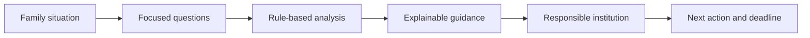

# zusek

ZUSek — a parent-first GovTech assistant helping families navigate benefits, plan parental leave, and simplify public administration. Built for HackNation 2026.

Project type: public-service innovation / civic technology / mobile-first service design
Challenge: Przewodnik przyszłej mamy (“Expectant Mother's Guide”), HackNation 2026, Poland
Status: functional browser-based proof of concept, not a production public service
Core technologies: HTML5, CSS3, JavaScript, rule-based eligibility guidance, optional NFZ public-data request
No official affiliation: independent prototype; not operated or endorsed by ZUS, NFZ, gov.pl, or mObywatel

**The problem
**Becoming a parent is a major life event. The administrative experience is fragmented across organizations, regulations, websites, and forms. Families encounter different entry points for benefits administered by ZUS, local municipalities, the Civil Registry Office (USC), the National Health Fund (NFZ), and employers.

**The solution**
ZUSek starts with a family's life event, not with the name of a form.

The interaction model follows three principles:
1. Tell us where you are. Choose pregnancy, a newborn, or a later parenting stage; provide only the context relevant to the question.
2. Understand your options. Review potential benefits and administrative pathways, with transparent reasons and missing information.
3. Know what to do next. Open the official source, find the responsible institution, and see the important next step.

Wyśmienity projekt na HackNację
